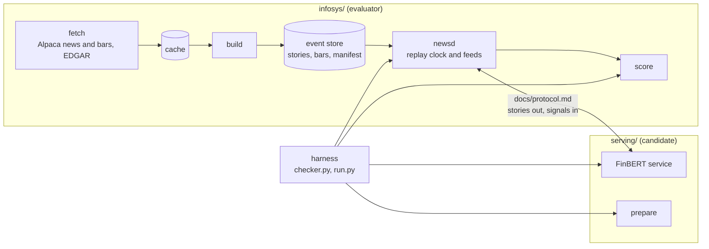

# news-signal

A latency benchmark for a FinBERT news-to-signal service. Financial news stories arrive on several feeds. The
service reads each story, classifies the headline with FinBERT, and posts back one trading signal per
`(story, ticker)` pair: a direction (-1, 0, 1) and a confidence. The benchmark measures how fast the signal comes
back and whether it still predicts the 5-minute forward return.

The repo was built as a task for VibeSys, where an AI agent optimizes the service for p99 latency on one AMD
MI210. It also works as a plain benchmark you can run by hand.

## Why it is built this way

An optimizer can cheat a latency benchmark in many ways: skip the model, emit constant signals, peek at future
stories, memoize the scoring data, or starve the clock that measures it. The design closes those routes:

- **A real baseline.** The starting service is a Hugging Face FinBERT classifier.
  A faster service must reproduce its signals (see "Quality rule").
- **Two codebases that share one document.** `infosys/` (evaluator-owned) and `serving/` (the candidate) share
  only `docs/protocol.md`. `tests/test_boundaries.py` checks that neither imports the other.
- **Pinned evaluator.** Digests of `infosys/` and of `pyproject.toml`, `uv.lock` and `docs/protocol.md` are pinned
  in `.vibesys/tasks/news-signal/gate.toml`. A pass is refused, before it runs, if any of them differs. The
  harness runs `uv run`; the pinned `pyproject.toml` and `uv.lock` keep the dependencies fixed.
- **No candidate imports in the gate.** The gate never imports from the candidate tree except the digest-verified
  `infosys/`, which is loaded by path (the repo root is never on `sys.path`) and re-verified at the end of the pass.
- **Hidden scoring data.** On real data, the candidate runs where the data cannot be seen (see "The hiding
  wrapper").
- **A fair clock.** Latency starts when `newsd` hands the story over, and a pass is thrown out if `newsd` itself
  falls behind.
- **No degenerate wins.** The pass fails if the signals use fewer than two directions, or if they stop matching the
  baseline FinBERT's.

The full candidate rules are in [`.vibesys/tasks/news-signal/OBJECTIVE.md`](.vibesys/tasks/news-signal/OBJECTIVE.md).

## Architecture



`infosys` and `serving` share only [`docs/protocol.md`](docs/protocol.md). The harness drives `newsd`, the
service and the scorer from `.vibesys/tasks/news-signal/`.

- **fetch** (`infosys/fetch`) pulls Alpaca news and one-minute bars for 25 large-cap tickers, plus EDGAR 8-K
  filings, into a resumable on-disk cache.
- **build** (`infosys/build.py`) turns the cache into the event store: gzip JSON-lines stories, minute bars as
  `.npz`, and a sha256 `manifest.json`. The store has train, validation and holdout splits in time order.
- **newsd** (`infosys/newsd.py`) replays one split over HTTP and WebSocket. It offers six feeds with different
  delays, drops and duplicates, and it accepts signals. It rejects a signal for a story that has not been sent
  yet, so the service cannot read ahead.
- **serving** (`serving/`) is the candidate. `serving.prepare` may train on the train file and write files for
  later. `serving` subscribes to every feed and posts signals.
- **score** (`infosys/score.py`) computes per-pair latency, missed and duplicate pairs, and IC.
- **harness** (`.vibesys/tasks/news-signal/`) runs a pass: it verifies the pins, builds the train file, runs
  `prepare`, starts the service, replays the split through `newsd`, and scores the result.

**Replay clock.** Stories replay in publication order. Gaps between stories are compressed and capped, so a
trading day replays in minutes. The accuracy gate replays a fixed sample at a high rate. The benchmark replays
the busiest five-minute windows of the validation split, up to 180 s, with gaps capped at 0.25 s.

**Latency.** The latency of a pair is the time from `newsd` handing the story to the service (on the earliest
feed) to the first accepted signal for the pair. Both instants are on `newsd`'s clock. A pair never signaled
counts as missed. [`docs/protocol.md`](docs/protocol.md) has the exact definition.

**Validity.** `newsd` records how late each delivery was against its schedule (send lag). A pass is valid only if
p90 send lag is at most 5 ms and p99 is at most 50 ms. The harness reruns an invalid pass once. A second invalid
pass is an error, not a result. The service process runs at nice 10, so its threads cannot starve `newsd`.

**Early finish.** After the last story is released, `newsd` ends the pass once every measured pair has a signal
and 5 s pass with no new accepted signal. The drain still has a hard cap.

**Quality checks.** The accuracy gate and the bursts pass both need direction agreement >= 0.99 and signal
Spearman >= 0.95 against the hidden reference, and the bursts pass also fails if the signals use only one
direction. See "Quality rule".

### Quality rule

Quality is fidelity to the original FinBERT, in the style of MLPerf's reference accuracy: the reference is the
unmodified model's signal for every validation `(story, ticker)` pair, computed once by the freeze on CPU in fp32
and stored in the scoring data (`reference/validation.jsonl.gz`), so the hiding wrapper hides it from the
candidate. Its sha256 is pinned in `gate.toml`, and a missing or different file fails the gate closed. A candidate
must agree with the reference direction (sign of `direction * confidence`; neutral agrees only with neutral; a
missed pair is a disagreement) on at least 99% of pairs, with a signal Spearman of at least 0.95, computed over the pairs where both signals are non-neutral (the neutral zeros are ties that would hide a constant or faked confidence; below 30 such pairs it is undefined and fails). The reference is
derived from private data and is never committed.

Why not an IC floor: on the real validation split the baseline's IC is indistinguishable from zero at every
horizon (5, 15, 30, 60 min: +0.007, -0.013, -0.008, -0.009 with a standard error of about 0.012). The headlines
coincide with price moves rather than lead them, so a floor of baseline minus two standard errors would be about
-0.02 and random signals would pass it. IC is still computed and reported, for information only.

## The hiding wrapper

On every real-data pass, both `serving.prepare` and the service run inside a wrapper that:

- creates an unprivileged user and mount namespace;
- mounts an empty tmpfs over the scoring data directory;
- binds the repo, the prepare work directory, the home directory and the cache directories read-only for the
  service, and points scratch and cache variables at a tmpfs that is discarded, so nothing the service writes
  survives the attempt;
- drops all capabilities and sets no-new-privs before exec, so the mounts cannot be undone.

The wrapper fails closed: if the namespace, a mount or the capability drop cannot be set up, the pass is refused
and nothing falls back to running unwrapped. The harness process is also marked not dumpable.

Three things stay rule-based, because the wrapper does not enforce them: submounts under the paths it covers,
the network (the harness does not restrict it), and detecting which pass the service is in. The candidate rules
forbid all three. `scripts/wrapper_probe.py` checks the wrapper on a GPU node (see the `probe` stage below).

## Layout

| Path | What it holds |
| --- | --- |
| `docs/protocol.md`, `docs/protocol-examples.json` | The wire contract and one valid example per message. |
| `infosys/` | Evaluator: fetch, build, store, replay, `newsd`, score, and a synthetic fixture. |
| `infosys/fixtures/tiny/` | A small synthetic event store for tests and the CPU check. |
| `serving/` | The candidate: baseline FinBERT service and `prepare`. |
| `.vibesys/tasks/news-signal/` | The VibeSys task: `OBJECTIVE.md`, `REFERENCE.md`, `vibesys.input.toml`, `objectives.toml`, `gate.toml`, `passrun.py`, `accuracy_checker/`, `benchmark/`, `cpu_check/`, `data.manifest.json`. |
| `scripts/freeze_baseline.py` | Measures the baseline on real data and freezes the gate. |
| `scripts/wrapper_probe.py` | GPU probe of the hiding wrapper. |
| `scripts/scan_publish.py` | Pre-publish scan for paths, secrets and data files. |
| `tests/` | Boundary and scan tests. Each package keeps its own `tests/`. |

## Setup

You need [uv](https://docs.astral.sh/uv/) and Python 3.12. The lockfile targets x86-64 Linux and pulls CPU wheels
of torch.

```bash
uv sync --frozen
```

To keep the CPU environment outside the checkout, set `UV_PROJECT_ENVIRONMENT` to a directory of your choice
before any `uv run`. `cpu_check/run.sh` does this itself and uses `$XDG_CACHE_HOME/news-signal/venv`.

## Data pull

The real data comes from Alpaca (news and bars) and SEC EDGAR. You need an Alpaca key file in dotenv format.
Pass it with `--env-file`. Never commit it. The fetch CLI prints counts only, never keys. EDGAR asks for a
contact address: pass `--contact-email` with a real address (a `noreply` address is rejected), or use `--skip-edgar` to leave
EDGAR out.

```bash
uv run python -m infosys.fetch --env-file <key file> --cache <cache dir> [--start YYYY-MM-DD] [--end YYYY-MM-DD]
uv run python -m infosys.build --cache <cache dir> --out <store dir>
export NEWS_SIGNAL_DATA=<store dir>
```

The fetch is resumable. The harness reads the store from `NEWS_SIGNAL_DATA`, and it refuses a store whose
files do not match the manifest pinned in `.vibesys/tasks/news-signal/data.manifest.json`. The freeze script
copies the pin from the store (stage `manifest`). Data stays out of git: the scan and the candidate gates both
reject data files.

## Running locally

Run the tests:

```bash
uv run pytest -q infosys serving tests .vibesys/tasks/news-signal/tests
```

Run the CPU check. It builds a tiny random BERT, replays the synthetic fixture through `serving/`, and prints
`PASS` when no pair is missed or duplicated and no signal is rejected. It takes about 20 s and needs no GPU or
real data.

```bash
.vibesys/tasks/news-signal/cpu_check/run.sh
```

## Running the benchmark on an MI210 Slurm cluster

1. **Operator setup.** The cluster's setup script exports `NEWS_SIGNAL_DATA` (the store, copied to the cluster),
   `HF_HOME` (a cache holding `ProsusAI/finbert`) and `HF_HUB_OFFLINE=1`.
2. **Environment.** The cluster venv gets a ROCm build of torch in place of the CPU wheel. Every other package
   matches `uv.lock`.
3. **Under VibeSys.** The task runs two commands from the repo root on the GPU node. They are the `[accuracy]`
   and `[benchmark]` commands in `vibesys.input.toml`:

   ```bash
   uv run python .vibesys/tasks/news-signal/accuracy_checker/checker.py
   uv run python .vibesys/tasks/news-signal/benchmark/run.py --mode bursts --vs-output <path>
   ```

   VibeSys appends `--vs-output` itself and reads the `p99_latency_ms` and `p50_latency_ms` objectives.
4. **Final report.** After a run, score the holdout split once. The holdout is for this report only, never for
   choosing between candidates:

   ```bash
   uv run python .vibesys/tasks/news-signal/accuracy_checker/checker.py --report --split holdout
   uv run python .vibesys/tasks/news-signal/benchmark/run.py --mode bursts --split holdout --vs-output <path>
   ```

### Freezing the baseline

The gate has no meaning until the unmodified `serving/` has been measured on real data. Until then
`gate.toml` has `frozen = false` and the accuracy gate fails on purpose. After the data pull, run, from a clean
checkout on the run host:

```bash
NS_GPU_SSH=<cluster ssh target> NS_CAMP=<work dir on the cluster> NS_SBATCH=<sbatch wrapper> \
NS_PARTITION=<partition> NEWS_SIGNAL_DATA=<store dir> python3 scripts/freeze_baseline.py
```

The script is idempotent and uses only the standard library. Its stages, in order:

| Stage | What it does |
| --- | --- |
| `manifest` | Copies the store's manifest into the task as the pin. |
| `pin` | Writes the digests of `infosys/` and of `pyproject.toml`, `uv.lock`, `docs/protocol.md` into `gate.toml`. |
| `budget` | Checks the bursts replay has at least 300 stories, or raises the window budget. |
| `cpu-acc` | Runs the baseline on CPU in fp32 over every validation story, from a clean tree. Writes the reference signals into the store, pins their sha256 in `gate.toml`, and records IC at every horizon (5, 15, 30, 60 minutes). This stage is slow and prints no progress. |
| `h` | Fixes H = 5 and prints the IC-by-horizon table. IC is record only, so this stage never stops the freeze. |
| `sync` | Refuses a dirty `serving/` or `infosys/`, then copies the checkout and store to the cluster. |
| `probe` | Not in the default run. A GPU job that checks the hiding wrapper. Run it with `--stages probe`. |
| `f1` | GPU job: the accuracy checker on the baseline, in report mode. The freeze stops if the GPU baseline's agreement is under 0.99 or its Spearman under 0.95 against the CPU reference. |
| `f2` | GPU job: the bursts benchmark, twice. Each pass's agreement is recorded. |
| `freeze` | Writes `gate.toml`, `objectives.toml` and the baseline section of `REFERENCE.md`. |

A stage's output is reused only if the commit, digests, H and `passrun.py` are unchanged. `--force STAGE`
redoes one stage and `--stages a,b` runs a subset. The script keeps the id of each submitted job until its
output is collected, so an interrupted run resumes the same job instead of submitting another. It also hides the
cluster address and paths from its own output. Details are in the docstring of
[`scripts/freeze_baseline.py`](scripts/freeze_baseline.py).

## Results

The baseline is pending. No real data has been pulled yet, so `gate.toml` holds placeholder values and
`frozen = false`. Running `scripts/freeze_baseline.py` after the data pull fills `gate.toml` and the baseline
section of `.vibesys/tasks/news-signal/REFERENCE.md` with: the reference pair count and digest, the baseline's own
agreement and Spearman, IC and its standard error (record only), the horizon H, validation stories and scored
pairs, the baseline p99 latency on two runs, and the relative noise. This section will then list them.

## Publishing

Before publishing a change, scan the tree and the full git history:

```bash
uv run python scripts/scan_publish.py [--deny <patterns file>] --history
```

It prints `file:line: rule` for each finding, never the matched text, and exits 1 on any finding. Its rules cover
absolute paths, tokens from the deny list, key-shaped secrets, data files outside the fixtures, and files over
1 MB.

## License

MIT. See [`LICENSE`](LICENSE).
